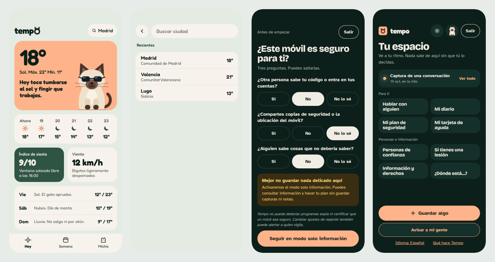
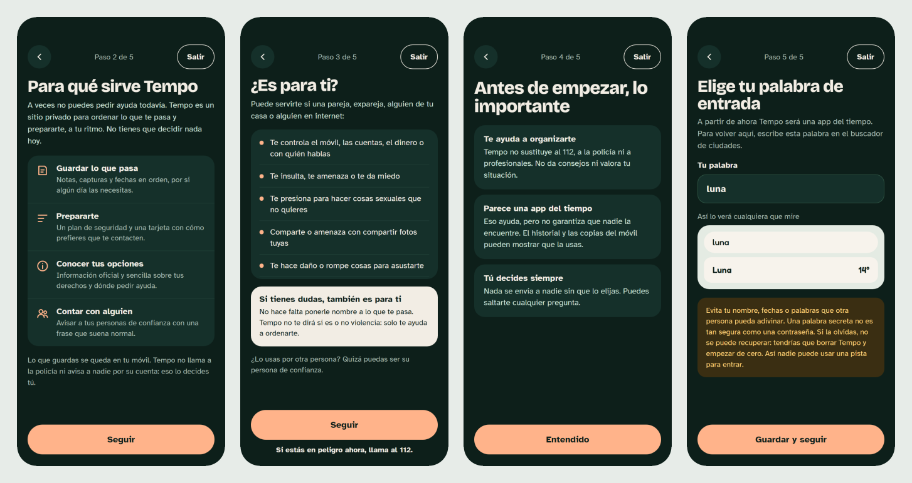
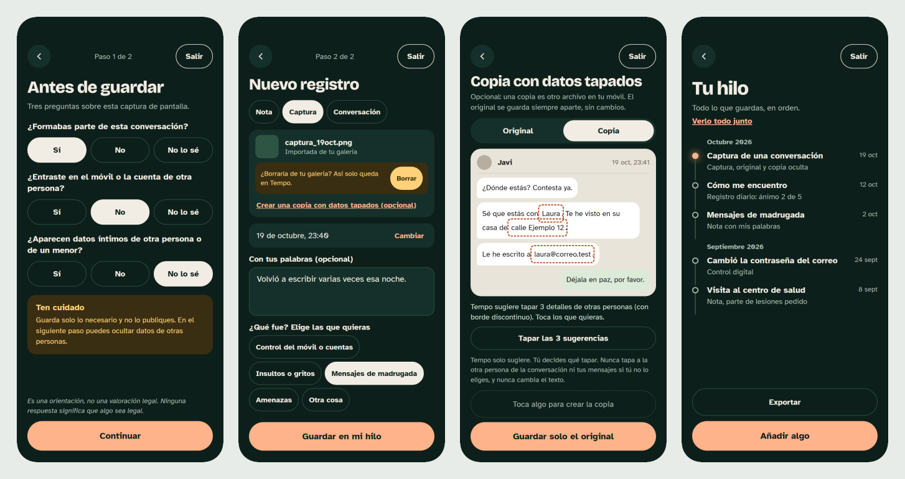
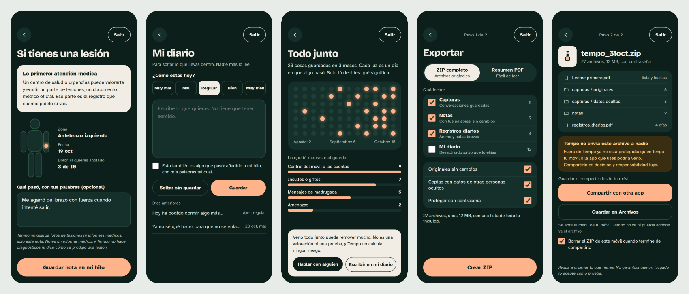
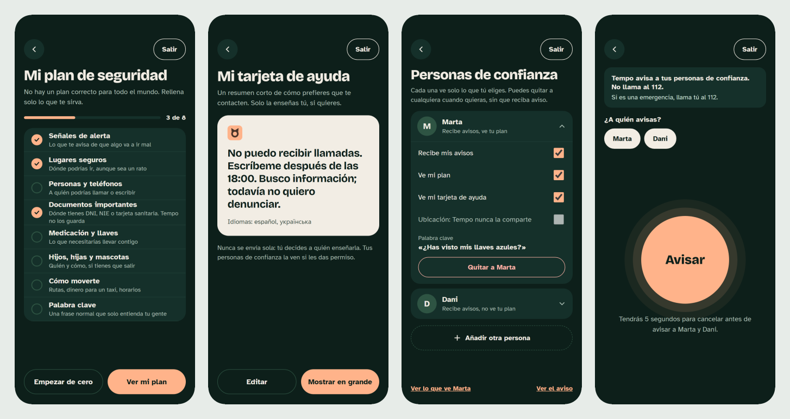
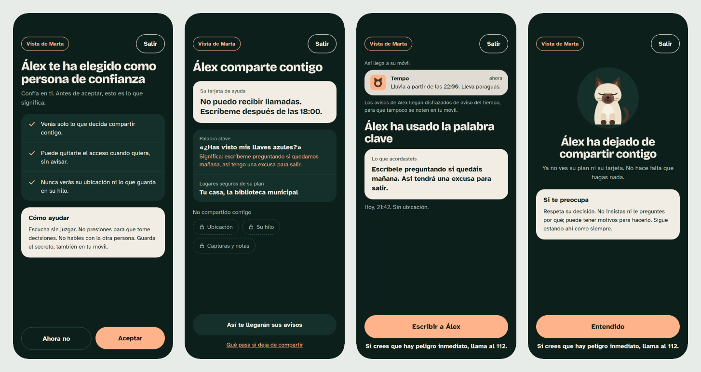
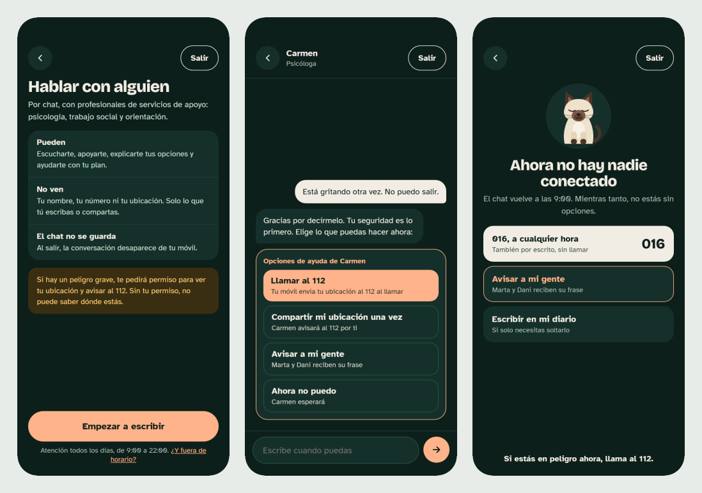
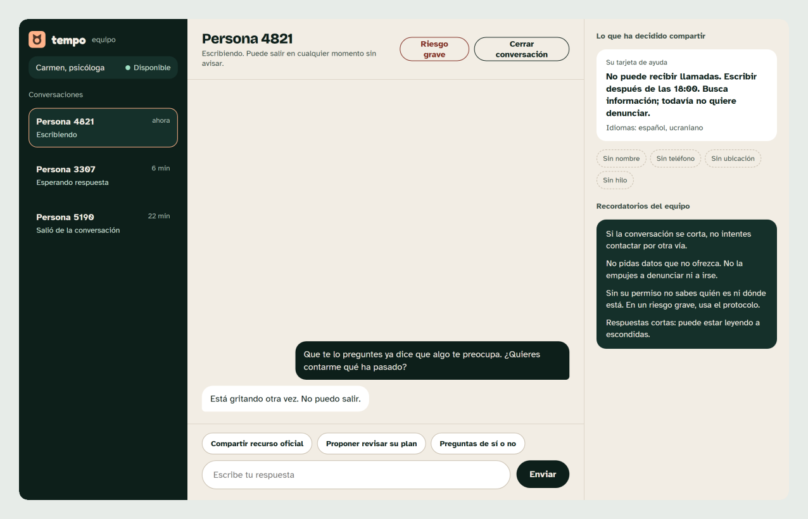
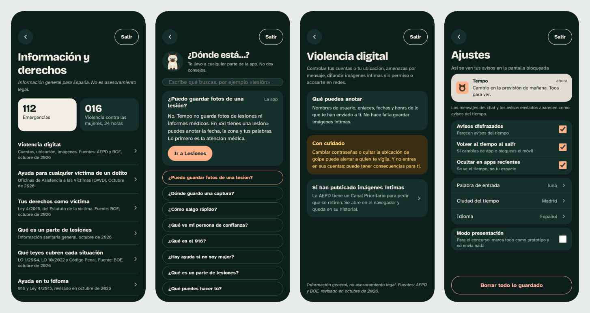

# Tempo: a discreet support app

*Project overview for review. The screens below are from the interactive design of the app; the interface is in Spanish, with English explanations here.*

## 1. What Tempo is

Some people who experience domestic, sexual, gender-based or digital violence cannot ask for help straight away. They may first need privacy, time and a way to put their thoughts and evidence in order. **Tempo is a private space for that first step.**

On the phone, Tempo looks like an ordinary, cheerful **cat weather app**. Behind it is a private area where a person can:

- **save** notes and screenshots in an organised timeline,
- **prepare** a safety plan and a card that explains how they prefer to be contacted,
- **write** freely in a private diary,
- **tell trusted friends** with a phrase that sounds normal,
- **talk** to a professional by chat,
- **find** clear, official information about their rights and where to get help.

Tempo is for any adult affected by this kind of violence, whatever their gender, and for the friends who support them. **All the language in Tempo is gender neutral**, in the screens, the information and the examples, because anyone can be a victim. Where an official service is limited to certain people (the 016 helpline, for example, covers violence against women), the app says so accurately and also points to services that help any victim of a crime. It never judges a situation, scores a risk or tells anyone what to do. The person always decides.

**What Tempo is not:** it does not call the police or the emergency number 112, it does not replace lawyers, doctors or psychologists, and it does not claim that saved material will be accepted as evidence.

## 2. How it works

### 2.1 A cover that looks like a weather app, and a hidden way in

The visible app shows the forecast for a fixed city, a Siamese cat that comments on the weather, and a working week view and cat gallery, so anyone who opens it finds a complete app. The way in is hidden in the **city search**: typing a personal code word shows what looks like an ordinary town, and opens the private area. Every private screen has a **"Salir"** (exit) button that returns to the weather at once.

On first entry, a short **device check** asks whether someone else has access to the phone or its accounts. If the answers suggest monitoring, Tempo switches to **information-only mode**: saving, the thread and the diary are hidden, and only information and the safety plan remain.

*Left to right: the weather cover, the city search used as the hidden entry, the device check, and the private home.*

### 2.2 Setup in five steps

A short first-time introduction: language (Spanish, English, Ukrainian or Romanian), what Tempo is for, "Is it for you?" (a list of situations, never a diagnosis), the app's limits, and the personal entry word. If the entry word is forgotten it cannot be recovered (see section 3).

### 2.3 Saving records carefully

Saving a screenshot starts with **"Before you save"**, three questions: was the person part of the conversation, did they use someone else's phone or account, does it show another person's private information or a child. The answer is a plain-language caution, never a statement that something is legal. A record can be a note, a screenshot or an exported conversation. The person adds their own words and tags. If the person wants to show a screenshot to someone, they can optionally make a **copy with other people's details covered**. Tempo suggests names, addresses and contacts, but the person taps to cover or uncover each one, and Tempo never covers the other person in the conversation, or the person's own messages, unless the person chooses to. The original is always kept unchanged, because a copy with covered parts could be challenged as edited. Everything appears in a dated **thread**.

### 2.4 Injuries, diary, the whole picture and export

- **Injuries:** the screen starts with the advice to see a doctor, and explains the medical report (*parte de lesiones*), which is the official record. The person can note the date, the body area and what happened in their own words. Tempo does not store injury photos or medical reports.
- **Diary:** a mood check and free writing. **"Soltar sin guardar"** lets the person write and let go without saving anything.
- **All together ("Todo junto"):** a 12-week calendar of small lights, one for each day something was saved, plus the tags the person chose. People often think "it's nothing", and seeing it together can change that. It shows only their own entries, with no score or judgement, and it offers support right there.
- **Export:** the person chooses what goes in (the diary is off by default), the format (ZIP or PDF summary), whether to include originals or hidden-detail copies, and a password. The ZIP includes a list of every file with its fingerprint, and Tempo offers to delete it after sharing. **Tempo never sends the file itself**: there is no sending inside the app, not even to the professional chat. The person saves it or hands it to another app through the phone's own menu, and what happens to it after that is their decision and responsibility.

### 2.5 Plan, help card and trusted people

The **safety plan** has eight sections (warning signs, safe places, people, documents, keys, children and pets, transport, code phrase). Tempo reminds the person where their identity documents are; it never stores them. The **help card** is a short message about how to be contacted, which the person can show full-screen. **Trusted people** are added preferably in person, with a code that expires in ten minutes, so no message is sent. Each has their own code phrase and their own permissions (receive alerts, see the plan, see the card). Location is never shared. **"Avisar a mi gente"** alerts the chosen people after a five-second cancel window. It states clearly that it does not call 112.

### 2.6 What the trusted person sees

The friend has Tempo too. They see an invitation that explains what they can and cannot see, the information the person chose to share, the alert (which arrives as a **weather notification**, so it does not stand out on their phone either) and a calm screen if access is removed.

### 2.7 Talking to a professional

A chat with trained staff from a support service, designed to be anonymous and not stored on the phone. If the person is in serious danger the professional cannot act alone, because they do not know who or where the person is. They send **help options** and the person chooses: call 112 (the phone then sends its location automatically), share their location once, alert their trusted people, or say "not now". Out of hours, the app shows 016, 112 and other options.

**Language is visible at every step of the chat.** The chat opens by showing the language the person chose in the app. The staff console shows that language as a clear badge beside the person's name, not only inside the help card. Staff reply in that language, or use an interpreter if they do not speak it, and the help options appear in the same language. Staff are reminded to use gender-neutral wording and to ask rather than assume how the person describes their situation or relationship. The words that bring up the help options (such as "miedo") are checked in every supported language, not only in Spanish. Translations beyond Spanish still need checking by native speakers before any live use.

The professionals' side is a desktop console with a protocol for serious risk and reminders for staff, such as never contacting the person another way and keeping replies short.

### 2.8 Information, helper and settings

- **Rights and information:** the emergency number 112, the 016 helpline, victim support offices (open to any victim of a crime), victims' rights, what a medical report is, which law covers which situation, and **digital violence**, including the data-protection agency's priority channel for removing intimate images. Each topic shows its source and review date.
- **"¿Dónde está…?":** a cat helper that only helps find the right screen and gives general information. It does not give advice.
- **Settings:** disguised notifications, returning to the weather when leaving the app, hiding the private area in the recent-apps view, a change of entry word, and **"Borrar todo"**, which deletes everything after a typed confirmation.

## 3. Common concerns: privacy and safety

**Where is the data stored?** By design, only on the person's phone. There are no accounts, no tracking and no advertising. Nothing is uploaded unless the person exports or shares it.

**Medical records and injury photos.**
- **Tempo does not store medical reports or injury photos.** The official medical record stays with the health service. Tempo keeps only a short note (date, body area, the person's own words), and the screen always puts seeing a doctor first.
- Health data is a special category under the GDPR, so Tempo avoids holding the most sensitive material at all. What it does hold stays on the phone, is kept to a minimum, and can be deleted by the person at any time.
- Tempo never stores identity documents (DNI, passport).

**Screenshots and other people's information.**
- Keeping a conversation you took part in is different from accessing someone else's phone or accounts, which can be a crime in Spain (Código Penal, arts. 197 and 197 bis). "Before you save" asks about exactly that and never says that something is legal.
- If the person wants to show a screenshot, they can make an optional copy with other people's names, addresses and contacts covered. Tempo only suggests; the person decides what to cover, and the original always stays unchanged.
- After importing a screenshot, Tempo offers to delete it from the gallery.
- A saved record, a screenshot or a file fingerprint does not guarantee that a court will accept it. Tempo says so.

**What if someone finds the app?** The weather cover reduces visibility but cannot guarantee secrecy, and Tempo says so. Extra protections: an exit button on every screen, return to the weather when leaving the app, a hidden recent-apps preview, disguised notifications, information-only mode on risky phones, and "Borrar todo". Deleting inside Tempo cannot remove copies that already left it, such as exports or phone backups.

**What if the person forgets their entry word or a password?**
- **Entry word:** it cannot be recovered. Tempo has no accounts, email address, phone number or security questions, so there is nothing to reset, and nobody else (including someone with access to the phone) can use a reset or a hint to get in. The weather app keeps working normally. To get back into the private area the person deletes Tempo and installs it again, and records kept only on the phone are lost. Setup says this before the word is saved: it cannot be recovered, and the only way back is to start from scratch.
- **Export (ZIP) password:** Tempo cannot open or reset it. Only that file stays locked; the originals are still in Tempo, so the person can create a new export with a new password.
- **Professional chat:** there is no password, because the chat is anonymous.

**Is anything sent to the internet?** Apart from the chat and the sharing the person chooses to use, only the weather request, for a fixed city and with no location access. The entry word is checked on the phone and is never sent anywhere.

**Exports and trusted people.** Tempo never sends an export itself, because it cannot protect a file once it leaves the app. The app warns about this, and anything the person shares from their phone is their decision and responsibility. Trusted people see only what the person allows, never the location, and can be removed without being notified.

**Law and data protection (Spain).** The design takes into account Ley Orgánica 1/2004 and 10/2022 (and that the first covers only violence against women by a partner), Ley 4/2015 on victims' rights, the Código Penal, the GDPR and Ley Orgánica 3/2018. Tempo gives general information, not legal advice.

## 4. How Tempo would reach people (marketing and spread)

*Future concept only. No organisation has agreed to any of this, and the contest includes no outreach.*

**The principle: quiet, trusted spread, not advertising.** Some people using Tempo may not want anyone to know they are looking at it. Loud marketing can reveal what someone is searching for, and targeted ads based on browsing could reveal it too. So Tempo would spread through people and services the person already trusts. It would never try to find people who might be at risk.

**The disguise problem.** Tempo's cover only works if people don't know that the cat weather app is Tempo. Any public material that shows the app's name or icon next to what it really does also teaches the person causing harm what to look for. So:

- Printed or public material never shows the weather cover, the app icon or the hidden way in.
- How the cover and the entry word work is explained in person, by trained staff, at the moment someone decides to install it.
- Cards are made to be read where they are handed over, not carried home.
- How the app is listed in the app stores is an open question. A store listing has to describe the app honestly, so it cannot simply say "weather app", but a listing that names its real purpose weakens the cover. This must be settled with legal advice and store-policy review before any launch.
- Downloading from a store leaves a record in the account's download history, and the person is told so before installing.

**How people would hear about it**

| Channel | How it would work | Why it fits |
| --- | --- | --- |
| **Support organisations** | Their staff offer the app one-to-one, in a private conversation, once the organisation agrees to it and its safety policy | The introduction comes from someone the person already trusts |
| **Health and social services** | Neutral information cards in clinics and social-services offices | Reaches people while they are already in contact with services, after institutional approval |
| **Community and migrant services** | Information in the person's own language, handed over privately | Avoids public lists that could name people |
| **Person to person** | A trusted person can mention it in their own words | Voluntary; no contact-list uploads, automatic invitations or referral tracking |
| **Printed cards and QR codes** | Short neutral cards with no app icon or screenshots, read where they are handed over; a QR code only in a private setting, with a note that browser history and download records can show use | Keeps the first contact low-profile and honest about its traces |

**What the message says**

- Neutral and plain: *"A private tool for organising information and exploring support options."*
- Always says what Tempo is not: not an emergency service, not a replacement for 112 or a professional.
- Never claims that the phone becomes safe or the app invisible.
- Uses the same languages as the app, checked by native speakers before use.

**What Tempo will not do**

- No paid ads, influencer sponsorships, viral videos or survivor testimonials.
- No retargeting, tracking pixels or marketing analytics that identify a person.
- No follow-up emails, calls or notifications unless the person asks for them.
- No claim that a charity, clinic or service supports Tempo until a written agreement exists.

**How it would be introduced, in stages**

1. **Now (contest):** the idea is explained to judges only. No outreach happens.
2. **Before any pilot:** independent security, privacy and legal review, a named responsible operator, written agreements with each partner, and a safeguarding plan.
3. **Small pilot with partners:** a few support services whose staff are trained to introduce the app, with a fixed review date.
4. **Wider use:** only if the pilot shows that people understand what Tempo does and does not do, and can use it safely. Any expansion would follow the same channels.

**How success would be measured:** whether people understand what Tempo does and does not do, whether referrals to support are safe, and whether people stay in control of their information. Downloads, active users and shares are not treated as success, and Tempo would not track them.
